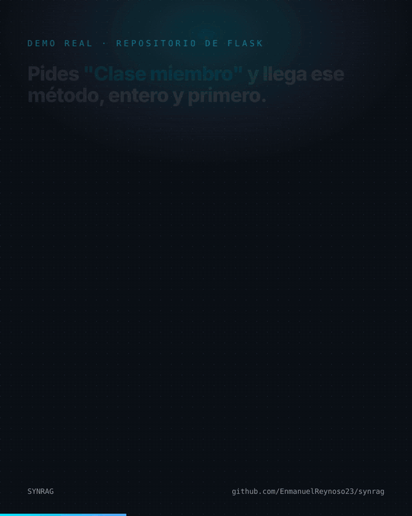
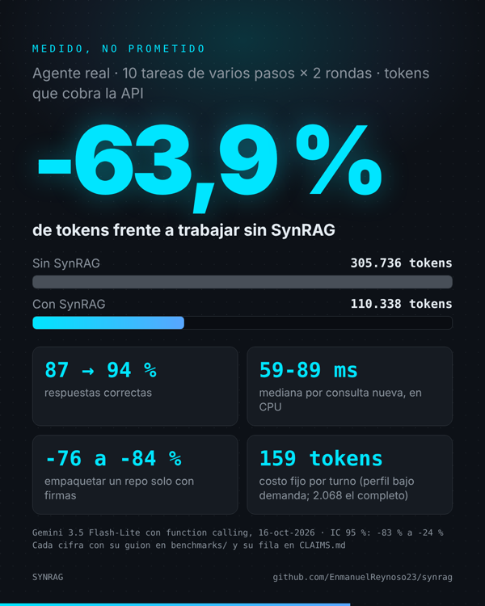

# SyntaxRAG (SYNRAG)

**Your coding agent stops reading whole files. Local MCP code search: AST chunks, CPU reranking and a dependency impact graph.**

[Español](README.md) · English

[](LICENSE)
[](https://www.python.org/)
[](https://modelcontextprotocol.io/)
[](https://tree-sitter.github.io/)
[](https://lancedb.com/)

<p align="center"></p>

To find one function, an agent without SynRAG greps and then reads whole files. SynRAG indexes your projects on your own machine, splits code by its syntax tree (functions, classes, methods, types) and hands the agent **the exact definition, who uses it and what breaks if you change it**. No GPU, no paid APIs, and your code never leaves your machine.

## Measured, not promised

Every number comes from a script in [`benchmarks/`](benchmarks) that you can rerun on public repos (Flask and Hono). Each one has its row, date and command in [`CLAIMS.md`](CLAIMS.md), including where SynRAG loses.

| What | Result |
|---|---|
| **Full system, real agent** (Gemini 3.5 Flash-Lite with function calling): 10 multi-step tasks × 2 rounds, counting every token the API bills | **-63.9 % tokens** (305,736 → 110,338; 95 % CI -83 % to -24 %), correct answers 87 % → 94 % |
| Find and read a function by name, vs grep + reading the range | Flask -36 to -38 %, Hono -52 %; the definition comes first in 92-100 % of cases |
| Natural-language questions | Flask -37 % |
| Pack a repo as signatures only (like Repomix `--compress`) | Flask -76 %, Hono -84 % |
| Import resolution for the impact graph, vs the TypeScript compiler and Python's `ast` | 100 % coverage, 100 % precision |
| Fixed cost per turn of the tool definitions | Full profile 2,068 tokens, `essential` 412, `bajo_demanda` (on demand) 159 |
| Latency of a new query, CPU only | 59-89 ms median; repeated query 3-4 ms from the cache |

**Where it loses:** on very short tasks it spends +117 %, because the tool definitions weigh more than the task (that is what the `essential` and `bajo_demanda` profiles are for). Agent measurements were made with Gemini, not Claude, and on bounded tasks, not long sessions.

<p align="center"></p>

## How it works

1. **Tree-sitter AST chunking** for TypeScript, TSX, JavaScript and Python: one function, method, class or type per chunk, never cut in half. Large classes and object literals are split member by member. Docs (Markdown, MDX, reStructuredText, AsciiDoc) go in ~200-token chunks with their heading path; SQL by statement.
2. **Locate before reading**: ask for a symbol (`useAuth`), a member (`Config.from_envvar` or `Config from_envvar`) or plain words. The exact definition comes first and whole, with a line of callers (`sessions.py:324 open_session, :373 save_session; imported by 3 files`); every other hit is one line. Candidates come from BM25 (Tantivy over LanceDB) and are reranked on CPU with TinyBERT (FlashRank).
3. **Dependency impact graph**: imports are read from the AST and resolved to files: relative paths, tsconfig `paths`/`baseUrl` (with `extends`), monorepo packages, barrels and Python modules. If two files define `useAuth`, `get_impact_radius` tells you who depends on each one.
4. **Optional watcher**: a systemd user service reindexes only the file you save (~8 ms for a small file).

## Install

Tested on Linux. It should work on macOS and WSL, but that is not tested yet.

```bash
curl -sSL https://raw.githubusercontent.com/EnmanuelReynoso23/synrag/main/install.sh | bash
```

The installer creates an isolated CPU-only virtualenv, adds the `SYNRAG` command and configures **only the AI tools you actually have installed**: it registers the MCP server and adds a short instruction block so the agent actually uses it. It backs up every file before touching it, never overwrites a JSON it cannot parse, and running it twice changes nothing. Preview first with `./install.sh --dry-run`; remove everything with `SYNRAG uninstall`.

| Agent | Status |
|---|---|
| Claude Code, Google Antigravity | Tested |
| Gemini CLI, Codex CLI, Cursor, Windsurf, Cline / Roo Code, Zed | Configured from their docs, not tested yet ([report how it went](https://github.com/EnmanuelReynoso23/synrag/issues/18)) |

### Claude Code plugin

The repo is also a Claude Code plugin marketplace. The plugin adds a skill that tells Claude when to use each SynRAG tool (~140 tokens per session):

```bash
claude plugin marketplace add EnmanuelReynoso23/synrag
claude plugin install synrag@synrag
```

## MCP tools

28 tools; `SYNRAG configure --perfil esencial` keeps only 5 and `--perfil bajo_demanda` starts with 2.

- **Search and orient:** `search_desktop`, `get_file_outline`, `repo_map` (PageRank over imports, within a token budget), `list_projects`, `reindex_desktop`
- **Before editing:** `get_impact_radius`, `find_related_tests`, `find_callers_exact`, `get_symbol_contract`, `extract_type_definition`, `get_import_graph`, `check_breaking_callsites`, `check_circular_imports`, `verify_dependency_exists`, `find_code_duplicates`
- **Edit:** `patch_function_body`, `add_import_clean`, `rename_symbol_scoped`, `remove_unused_imports`
- **Run with short output:** `run_test_isolated`, `lint_summary`, `run_typecheck_focus`, `tail_clean_logs`
- **Session:** `session_handoff`, `context_budget_alert`, `git_staged_overview`, `extract_todo_status`, `get_savings_report`
- **Optional, with your own `GEMINI_API_KEY`:** `ask_synrag_architect`, `explain_blast_radius`. Without a key the engine makes no network calls.

## CLI

```bash
SYNRAG "useAuth"                         # search with neural reranking
SYNRAG --project my-app "load config"    # filter by project
SYNRAG outline src/context.ts            # signatures and line ranges
SYNRAG impact HTTPException              # who imports it
SYNRAG tests compose                     # related test files
SYNRAG mapa my-app --tokens 1024         # repo map within a token budget
SYNRAG empaquetar ~/my-app --salida pack.md   # signatures-only pack for a web chat
SYNRAG index                             # reindex everything
```

## Contributing

Issues and PRs are welcome, in English or Spanish. The most useful contribution right now is trying the installer on an agent or OS marked as untested and telling what happened. See [CONTRIBUTING.md](CONTRIBUTING.md).

## License

MIT. Built by [Enmanuel Reynoso](https://github.com/EnmanuelReynoso23).
